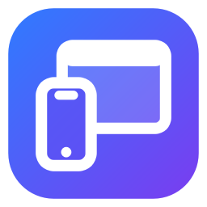
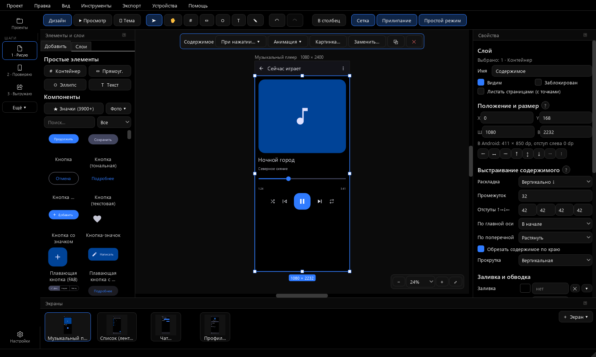
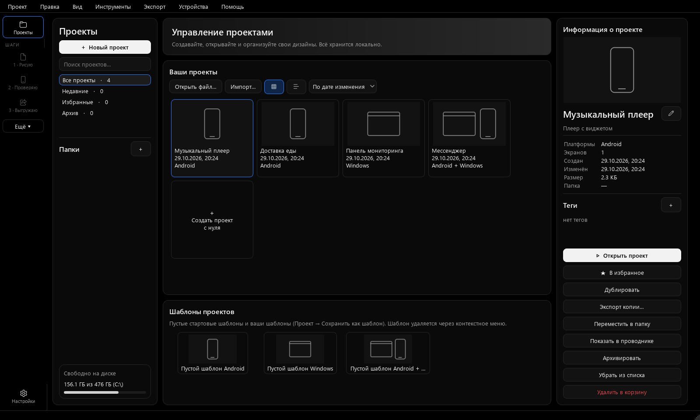
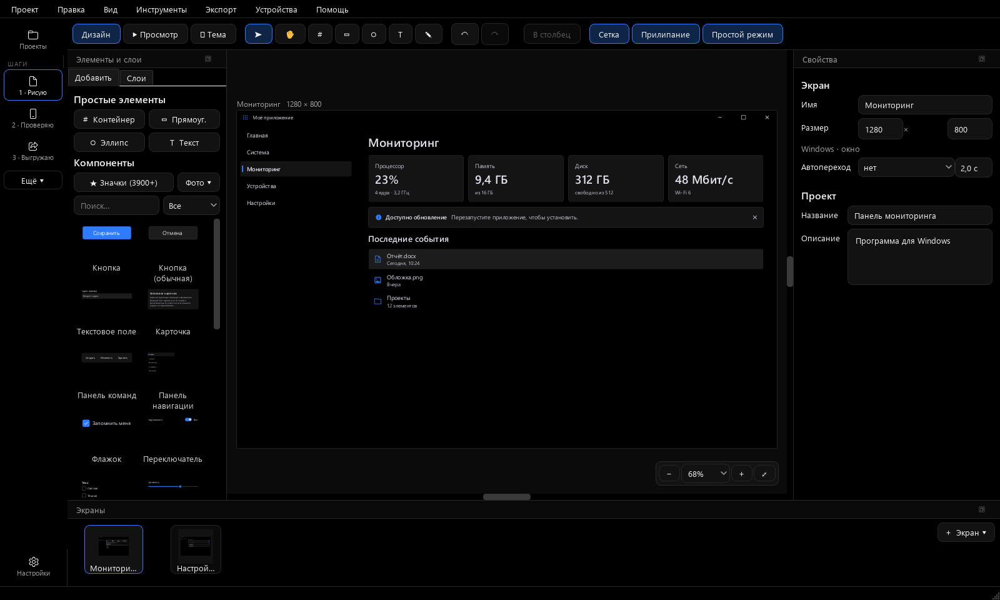
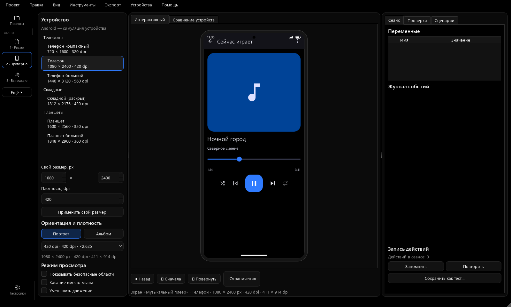
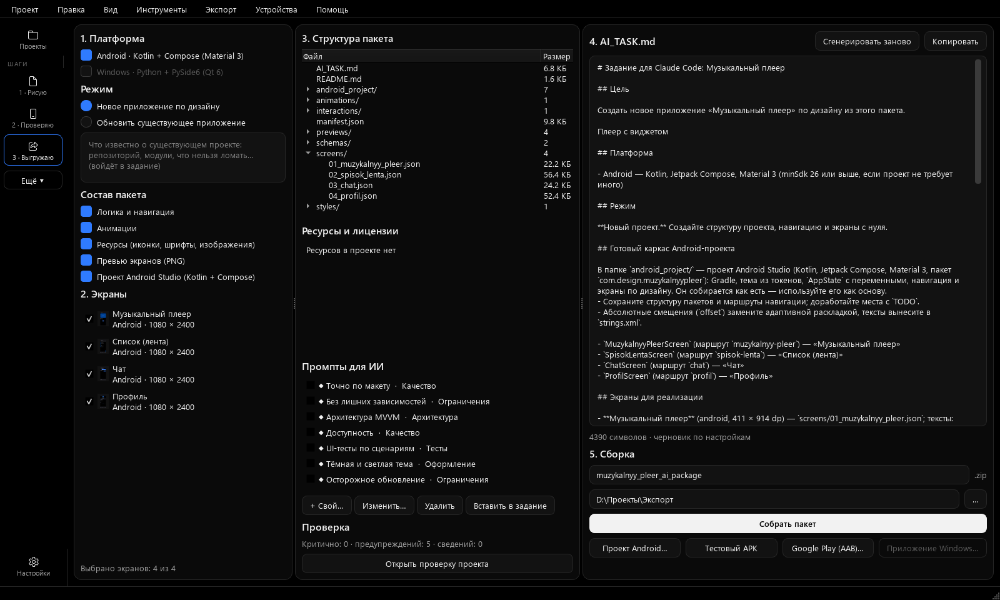

<h1 align="center">App Design Studio</h1>

<b>by Kirdev Software</b>

Студия дизайна приложений для <b>Android</b> и <b>Windows</b>: рисуете экраны, связываете их в живой прототип —
и получаете готовый проект Android Studio или программу для Windows. 
Бесплатно · без регистрации · работает без интернета

<a href="https://github.com/kirdev07/APPDesine-Studio---Kirdev_Software/releases/latest"><b>⬇ Скачать последнюю версию</b></a>

## Что умеет

**Дизайн**
- Холст с раскладкой как в Figma: столбцы, ряды, сетка, перенос, привязки к краям, «заполнить» и «по содержимому».
- 170+ заготовок и компонентов Material Design 3 (кнопки, поля, списки, вкладки, меню, карточки, листы, диалоги),
  поколения Material 1, 2, 3 и Expressive; 22 компонента Windows 11 (Fluent).
- ~3900 значков Google Material Symbols, свои шрифты, картинки и SVG, фото-заглушки.
- 49 готовых экранов Android, 5 готовых приложений (доставка, банк, путешествия, фитнес, магазин),
  готовые экраны Windows 11 и виджеты рабочего стола Android.
- Компоненты с вариантами и состояниями, 12 тем, светлая, тёмная и AMOLED, смена темы в один клик.
- Эффекты: тени, градиенты, матовое стекло, маски, операции с фигурами, графики.

**Живой прототип**
- Нажатия, удержание, двойное нажатие, свайпы, наведение, ввод текста, переменные и условия.
- Переходы между экранами с анимацией, умный переход (Smart Animate), шторки и всплывающие окна.
- Прокрутка, липкие элементы, листание страницами — вбок и вверх-вниз, как в лентах коротких видео.
- Предпросмотр на телефонах, складных и планшетах, сравнение устройств, запись и повтор сценариев.
- Прототип в браузере одним HTML-файлом — можно отправить кому угодно.

**Выгрузка**
- **Android:** готовый проект Android Studio — Kotlin, Jetpack Compose, Material 3, навигация, состояние,
  анимации, строки для перевода, подписи TalkBack, тёмная тема, сборка для Google Play.
- **Windows:** готовая программа на Python + PySide6 — настоящие элементы Windows 11, окно растягивается,
  текст переносится, всплывающие окна и правила работают.
- Экраны в PNG и PDF, пакет с заданием для ИИ-помощника (Claude Code).
- Проверка проекта перед выгрузкой: контраст, безопасные области, размеры касания, ресурсы и лицензии.

## Скриншоты

| | |
|---|---|
|  |  |
| **Все проекты** — Android, Windows или оба сразу | **Дизайн программы для Windows 11** |
|  |  |
| **Живой прототип** на выбранном устройстве | **Выгрузка** в проект Android Studio и программу Windows |

## Установка

1. Скачайте `AppDesignStudio-<версия>-win64.zip` со страницы [выпусков](https://github.com/kirdev07/APPDesine-Studio---Kirdev_Software/releases/latest).
2. Распакуйте в любую папку и запустите `AppDesignStudio.exe`. Python и интернет не нужны.
3. Windows может показать «Windows защитила ваш компьютер» — программа не подписана платным сертификатом.
   Нажмите «Подробнее» → «Выполнить в любом случае».

Требования: Windows 10 или 11, 64-бит, около 120 МБ на диске.

## Обновления

Раз в день при запуске программа спрашивает у этой страницы номер последней версии и предлагает
обновиться: скачивает архив, сверяет контрольную сумму SHA-256 и перезапускается уже в новой версии.
Никаких сведений о вас и ваших проектах не отправляется. Проверку можно выключить в «Настройках» или
проверить вручную: «Помощь → Проверить обновления».

## Приватность

- Без учётной записи, облака, рекламы и телеметрии. Проекты хранятся только на вашем компьютере
  (`Документы\App Design Studio`).
- Единственное обращение в интернет — проверка обновлений (выключается).

## Лицензия

App Design Studio — бесплатная программа с закрытым кодом © 2026 Kirdev Software.
Пользоваться можно бесплатно, в том числе для работы; всё, что вы нарисовали и выгрузили, принадлежит вам.
Нельзя продавать программу, изменять или декомпилировать её. Полный текст — [LICENSE](LICENSE).
Сторонние компоненты (PySide6 / Qt — LGPLv3, Google Material Symbols — Apache 2.0) —
[THIRD_PARTY_NOTICES](THIRD_PARTY_NOTICES).
